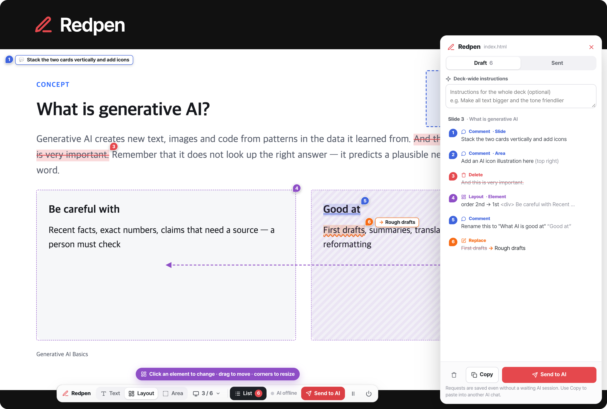

<div align="center">

#  Redpen

**Mark fixes on your AI-made HTML slides — the same AI session applies them.**

[한국어](README.md) · **English**

<p></p>

</div>

AI drafts HTML slides fast, but fixing them is tedious. Instead of typing "delete 'And this…' in the second paragraph on page 7", drag over it on the screen and press one key. Each mark becomes an edit request with the slide number, original text, surrounding context and source `file:line`, and goes to **the very Claude Code or Codex session that made the HTML**. When the AI is done, the page reloads by itself and its reply pops up.

## Quick start

Requires Node.js 18 or later.

```bash
npm install -g @woosopyi/redpen
redpen setup          # adds the redpen skill to Claude Code and Codex
```

In the AI session that made the slides, type `/redpen` (Claude Code) or `$redpen` (Codex), or just say "let's review with redpen", and the review page opens.

- Update: `npm update -g @woosopyi/redpen` — the installed skills catch up with the new version on your next `redpen open`.
- Remove: `redpen setup --remove && npm uninstall -g @woosopyi/redpen`
- From a clone of this repository (for development): run `node bin/redpen.mjs setup` in it — the command gets linked as `~/.local/bin/redpen` (or use `npm link` if that is not on your PATH).

## See it in action

### 1. Fix text — drag, then D · R · C


### 2. Change the layout — drag to move, pull a corner to resize


### 3. Areas and slides — empty space, layout sketches, whole slides


### 4. Send to AI — the same session fixes it and the page comes back


> These are real screen recordings. The deck in them is [`examples/showcase`](examples/showcase) — open it yourself: `redpen examples/showcase/en.html --lang en`

## How it works

```
 Browser (Redpen overlay)              Local server · .redpen/              AI session (Claude Code · Codex)
 ────────────────────────              ───────────────────────              ────────────────────────────────
 drag → delete · replace · comment
 [Send to AI]  ──────────────────▶  saves the edit request (round 1, 2 …) ──▶  redpen wait picks it up and prints it
                                                                                 ↓ the AI edits the HTML / slides.js
 auto-reload + reply toast  ◀─────  notices the file change · saves reply ◀──  redpen wait --reply "what changed"
```

- Your deck files stay untouched: the local server only injects the overlay script while serving them.
- The AI session keeps `redpen wait` running in the background, so you can go back and forth for several rounds while only looking at the browser.
- Requests are saved even when no AI is waiting. Say "apply my review" in the session later and it picks them up.

## Ways to start

### A. Continue in the AI session that made the HTML (recommended)

In the conversation that made the slides, say:

```
/redpen                       ← Claude Code
$redpen                       ← Codex
let's review with redpen      ← plain words work too
```

The AI opens the review page with `redpen open` and waits. Mark things, press **Send to AI** → the AI applies them → the page reloads → read the reply → mark again… To finish, press **⏻ Quit** at the right end of the toolbar, or tell the session "end the review".

### B. Open it yourself, apply later

```bash
redpen slides/index.html --lang en     # a folder works too: redpen slides/
```

Mark things, press **Send to AI**, then say "apply my review" in your AI session.
Without the skill, say: "apply the output of `redpen pending slides/index.html`".

### C. Paste into any AI chat

The **Copy** button in the list panel copies the edit request to the clipboard (it is kept in Sent as well).

Try it on the example deck: `redpen examples/basic-en/index.html --lang en` (or `npm run demo:en`).

## What you can do on the page

| To… | Do this |
|---|---|
| Delete text | Drag → **D** (or Delete / Backspace, or Delete in the menu) |
| Replace text | Drag → **R** → type the new text → Enter |
| Comment | Drag → **C** → type the instruction → Enter (Shift+Enter for a new line) |
| Select an image or box | **Layout** mode (Alt+2) → click (click inside again for the inner element, Alt+↑ for its parent) |
| Move an element | Drag the selected element — it snaps like a magnet to the slide's center and margins, other elements' edges and the purple areas (its original spot, sketch boxes, other elements' target boxes); hold Alt to turn snapping off. Dropping it near its original spot cancels the move. **Shift+arrow keys** nudge it (Shift+Alt: bigger steps) |
| Reorder | Drag onto another slot (a card, a list item) — it goes where the blue line shows, before or after |
| Resize | Corner handles = scale proportionally; side handles = only the box width / height (images always keep their proportions) |
| Font · gap · padding · direction · columns | In the layout bar: **Font −/+**, **Gap −/+** (flex / grid boxes), **Padding −/+**, **Vertical / Horizontal**, **Columns −/+** (grid), **Center** |
| Delete / comment on an element | Select it, then **D** / **C** (or Delete / Comment in the bar); **Reset** undoes its layout changes |
| Instruction for empty space | **Area** mode (Alt+3) → drag to draw a box → type the instruction |
| A whole slide | The slide menu in the toolbar (`3 / 24 ▾`) → comment · delete · **move** (to the front, one step, or to a number) |
| New layout sketch | Slide menu → **Sketch a new layout** → drag on empty space to draw boxes, write what goes in each ("big photo", "3 lines of text"), then **Done** |
| Instructions for the whole deck | **Deck-wide instructions** at the top of the list panel |
| Edit or remove a mark | Click the marked text or its number pin → switch the type (delete ↔ replace ↔ comment), edit or remove |
| Go to a mark | Click it in the list panel (uses the deck's own way of changing slides) |
| Undo / redo | ⌘Z / ⌘⇧Z (Windows: Ctrl) |
| Send | **Send to AI** or ⌘Enter |
| Use the deck as it is | ⏸ Pause (hides the marks and layout previews — handy for before/after comparisons) |
| Turn Redpen off | ⏻ Quit — tells a waiting AI session the review is over and stops the review server. Unsent marks are saved and come back next time |
| Move or collapse the toolbar | Drag / click the **Redpen** logo on its left (double-click: back to its place) |

- Turn slides with the deck's own keys (arrows, space…). In Layout mode the arrow keys still turn slides while an element is selected, and the deck's own ← / → buttons outside the slides work in every mode.
- Marks are saved automatically. After a reload, or after the AI edits the files, the remaining marks find their wording again. When the surrounding text changed too much to be sure, a mark is flagged "not found on the page" instead of being attached somewhere wrong (its original text is still sent).
- The toolbar shows the session status: **AI waiting** (green) / **AI working** (blue) / **AI offline** (gray).

## What the AI receives (example)

```markdown
# ✒️ Redpen edit request · round 1

- File: `/Users/me/slides/data-101/index.html`
- Sources that hold the content: `index.html`, `slides.js`, `deck.js`
- Slide numbering: `.slide` elements in document order (4 in total) — "Slide N" is the Nth one
- Requests: 🗑 Delete 1 · ✏️ Replace 1 · 💬 Comment 1

## How to apply
1. 🗑 **Delete** — remove only the marked text, element or slide. …

## Slide 3 · “Handling missing values”
Slide location: around `slides.js:23`

### #1 🗑 Delete element `<div>`
- Target: `<div class="box">` — content: "Delete Drop rows when only a few values are missing at random. …"
- Location: DOM `div#deck > section.slide:nth-of-type(3) > div.body > div.two > div.box:nth-of-type(1)` · Source: `slides.js:25`

### #2 ✏️ Replace text
- Original: `mean, median or mode`
- New: `mean or median`
- Location: DOM `… > div.box:nth-of-type(2) > p` · Source: `slides.js:26`

### #3 💬 Comment · text
- **Instruction:** move this tip above the boxes
- Original: `Before deleting missing values, find out why they are empty`
- Context: …this can distort the distribution. Tip: ⟦Before deleting missing values, find out why they are empty⟧. Data Analysis 10103…
- Location: DOM `div#deck > section.slide:nth-of-type(3) > div.body > p.note` · Source: `slides.js:28`
```

Even when the slide content lives in a script such as `slides.js` rather than the HTML, Redpen finds the visible wording in the sources and tells the AI **which file and line to actually edit**.

For layout changes, the AI gets "how it is laid out now (which slot of a flex / grid with how many columns)" and "what changed", with before → after numbers.

```markdown
### #3 📐 Layout change · element `<div>`
- Target: `<div class="card">` — content: "Be careful with Recent facts, exact numbers, …"
- Now: middle right of the slide (x 51–94%, y 37–85%) · the 2nd of 2 slots in `div.cols` (grid · 2 columns)
- Change:
  - Order: 2nd → 1st — before “Good at First drafts, …”
  - Size: scale up to 110% — keep the proportions (width 43% → 47%)
  - Font size: 24px → 29px (+21%)

### #4 📐 New layout sketch
- Rebuild this slide following the boxes below (a wireframe). The numbers are the reading order.
  1. "Big photo" — middle left (x 5–50%, y 30–90%) · there now: `<div>` "Good at …"
  2. "Three lines of text" — middle right (x 55–95%, y 30–90%) · there now: `<div>` "Be careful with …"
```

## Supported decks

- Decks that stack `.slide` elements and show one at a time (arrow keys, `#5` hash navigation), scrolling decks, reveal.js, decks built by JavaScript, and plain pages without slides
- Decks that scale a 1920×1080 stage with `transform: scale()`, including overview (grid) modes
- Click-to-advance decks don't advance while you drag or double-click text (clicks on empty space, the deck's buttons and videos still work). Text can be selected even in `user-select: none` decks
- If slide detection gets it wrong, set it yourself: `redpen open deck.html --slide "section.page"`

## Commands

| Command | What it does |
|---|---|
| `redpen <html>` / `redpen open <html>` | Open the review page (`--port`, `--slide <selector>`, `--lang ko\|en`, `--no-open`) |
| `redpen wait [html] [--reply "…"] [--timeout sec]` | (for the AI) Wait until the browser sends, then print the edit request. `--reply` answers the previous round |
| `redpen pending [html]` | (for the AI) Print pending edit requests |
| `redpen done [html] --reply "…" [--stop]` | (for the AI) Report the result to the browser and stop waiting. `--stop` turns the review page off too ("end the review") |
| `redpen status [html] [--json]` | Server address · whether an AI is waiting · sent requests |
| `redpen stop [html]` | Stop the review server (it also stops by itself after 2 hours without a browser) |
| `redpen setup [--claude] [--codex] [--remove]` | Link the command + install / remove the skill |

Without `html`, the file you opened last is used. Exit codes of `wait`: 0 = got an edit request, 2 = `--timeout` reached.

### Language (English / 한국어)

The page, the edit requests the AI receives and the command output come in English or Korean. By default Redpen follows your computer's language (on macOS, the system language). To choose:

- `redpen open deck.html --lang en` — if the page is already open, the server restarts on the same address and open tabs switch language too
- The `REDPEN_LANG=en` (or `ko`) environment variable — applies to every command

Each edit request is written in the language of the page it was sent from. Text inside the deck is passed on exactly as written.

## Where data is stored

Review data lives next to the deck in `.redpen/<file name>/`, and the `.gitignore` inside keeps it out of git automatically.

```
slides/.redpen/index.html/
  draft.json              marks in progress (saved automatically)
  rounds/0001.json        a sent edit request (raw data)
  rounds/0001.md          the prompt the AI receives
  rounds/0001.delivered   who took it (wait / pending / clipboard)
  rounds/0001.reply.json  the AI's reply
  server.json · server.log · agent.json
```

## Security

The review server listens on `127.0.0.1` only and rejects requests with a foreign Host or Origin (blocking DNS rebinding and writes from other sites). Other websites can't pull your deck files in through `<script>`, `` and the like either (`Sec-Fetch-Site`, `Cross-Origin-Resource-Policy`). Files outside the deck folder and dot files / folders (`.redpen`, `.git`, `.env` …) are never served. Symbolic links inside the deck folder (e.g. a large `assets` folder) are followed.

## Troubleshooting

- **The slide numbers are off** → `redpen open deck.html --slide "<slide element selector>"`
- **It says AI offline** → run `/redpen` (Claude Code) or `$redpen` (Codex) in your AI session, or send first and then say "apply my review"
- **The browser didn't open** → open the address printed in the terminal (`http://localhost:4545/…`) yourself
- **A red "lost the connection" notice** → the review server has stopped. Run `redpen open <html>` again and open the new address (marks you were making are saved once it reconnects)
- **I want to use the deck's own buttons or videos** → ⏸ Pause in the toolbar
- **Server log** → `.redpen/<file name>/server.log`

## Development

```bash
npm install          # puppeteer-core for the tests (uses your installed Chrome)
npm test             # unit tests
npm run test:e2e     # browser end-to-end tests (CHROME_PATH=… to pick the browser, HEADFUL=1 to watch)
npm run demo         # open the Korean example deck  (npm run demo:en for the English one)
npm run screenshots  # regenerate the README's top image (docs/hero*.png)
npm run media        # regenerate the README videos (docs/media/*.gif): record the real screen, then compose. Needs ffmpeg (FFMPEG=path)
```

Layout: `src/cli.mjs` (commands) · `src/server.mjs` (server, SSE) · `src/store.mjs` (file state) · `src/locate.mjs` (finding source locations) · `src/prompt.mjs` (the prompt) · `src/client/` (the browser overlay, dependency-free ES modules) · `src/client/i18n/` (Korean source text → English) · `skills/redpen/SKILL.md` (the Claude Code / Codex skill).
