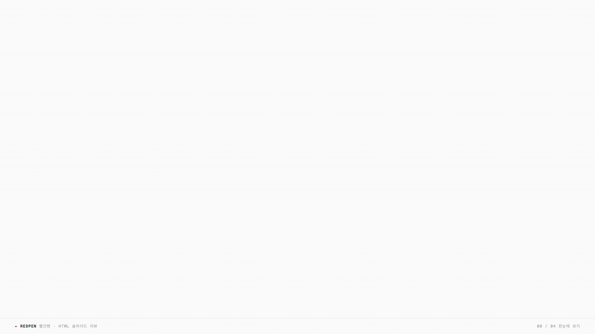
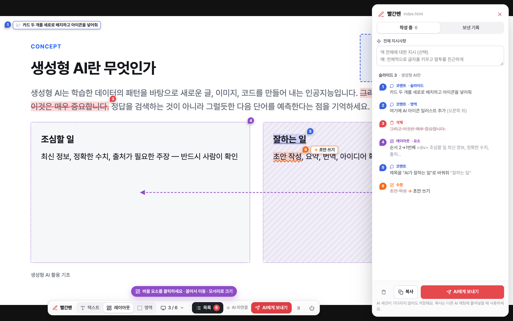

<div align="center">

# ✒️ 빨간펜 · redpen

**AI가 만든 HTML 슬라이드, 화면에 표시하면 그 AI 세션이 고칩니다.**

**한국어** · [English](README.en.md)



</div>

AI로 만든 HTML 슬라이드는 초안은 빠르지만 고치기가 번거롭습니다. "7페이지 두 번째 문단의 '그리고…' 지워 줘"처럼 말로 설명하는 대신, 화면에서 드래그하고 키 하나로 표시하세요. 표시는 슬라이드 번호·원문·앞뒤 문맥·소스 `파일:행`이 담긴 수정 요청이 되어 **HTML을 만들던 바로 그 Claude Code·Codex 세션**으로 전달되고, AI가 고치면 화면이 저절로 새로고침되며 답장이 뜹니다.

## 빠른 시작

Node.js 18 이상이 필요합니다.

```bash
npm install -g @woosopyi/redpen
redpen setup          # Claude Code·Codex에 redpen 스킬 설치
```

슬라이드를 만들던 AI 세션에서 `/redpen`(Claude Code) · `$redpen`(Codex), 또는 "빨간펜으로 리뷰하자"라고 하면 리뷰 화면이 열립니다.

- 업데이트: `npm update -g @woosopyi/redpen` — 설치된 스킬은 다음 `redpen open` 때 새 버전으로 맞춰집니다.
- 제거: `redpen setup --remove && npm uninstall -g @woosopyi/redpen`
- 저장소를 받아서 쓰려면(개발용): 저장소 폴더에서 `node bin/redpen.mjs setup` — 명령은 `~/.local/bin/redpen`으로 연결됩니다 (PATH에 없으면 `npm link`).

## 영상으로 보는 사용법

### 1. 텍스트 고치기 — 드래그하고 D · R · C


### 2. 레이아웃 바꾸기 — 끌어서 옮기고, 모서리로 키우기


### 3. 영역과 슬라이드 — 빈 공간, 새 배치 스케치, 슬라이드 통째로


### 4. AI에게 보내기 — 같은 세션이 고치고, 화면이 다시 열립니다


> 영상은 실제 화면 녹화입니다. 영상 속 덱은 [`examples/showcase`](examples/showcase)에 있어요 — 직접 열어 보기: `redpen examples/showcase/index.html`

## 동작 방식

```
 브라우저 (빨간펜 오버레이)              로컬 서버 · .redpen/                AI 세션 (Claude Code · Codex)
 ───────────────────────────            ─────────────────────               ─────────────────────────────
 드래그 → 삭제 · 수정 · 코멘트
 [AI에게 보내기]  ───────────────▶  수정 요청 저장 (1차, 2차 …)  ──────▶  redpen wait 가 받아서 출력
                                                                              ↓ AI가 HTML / slides.js 수정
 자동 새로고침 + 답장 토스트  ◀────  파일 변경 감지 · 답장 저장  ◀──────  redpen wait --reply "무엇을 바꿨는지"
```

- 덱 파일은 그대로 두고, 로컬 서버가 보여 줄 때만 오버레이 스크립트를 끼워 넣습니다.
- AI 세션은 `redpen wait` 를 백그라운드로 실행해 두고 기다리므로, 사람은 브라우저만 보면서 여러 차례 주고받을 수 있습니다.
- AI가 기다리고 있지 않아도 보낸 내용은 저장됩니다. 나중에 세션에서 "리뷰 반영해줘"라고 하면 이어서 반영합니다.

## 시작하는 방법

### A. HTML을 만들던 AI 세션에서 이어서 (추천)

슬라이드를 만들던 그 대화에서 이렇게 말하면 됩니다.

```
/redpen                 ← Claude Code
$redpen                 ← Codex
빨간펜으로 리뷰하자       ← 말로 해도 됩니다
```

AI가 `redpen open` 으로 리뷰 화면을 열고 기다립니다. 표시하고 **AI에게 보내기** → AI가 반영 → 화면 자동 새로고침 → 답장 확인 → 다시 표시… 를 반복합니다. 끝내려면 툴바 맨 오른쪽 **⏻ 종료**를 누르거나 세션에 "리뷰 끝"이라고 하세요.

### B. 직접 열고, 나중에 반영

```bash
redpen slides/index.html        # 폴더를 줘도 됩니다: redpen slides/
```

표시하고 **AI에게 보내기** 를 누른 뒤 AI 세션에서 "리뷰 반영해줘"라고 하면 됩니다.
스킬 없이 쓰려면 "`redpen pending slides/index.html` 결과를 반영해 줘"라고 하세요.

### C. 아무 AI 채팅에 붙여넣기

목록 패널의 **복사** 버튼을 누르면 수정 요청이 클립보드에 복사됩니다 (보낸 기록에도 남습니다).

## 화면에서 하는 일



| 하고 싶은 것 | 방법 |
|---|---|
| 텍스트 지우기 | 드래그 → **D** (또는 Delete·Backspace, 메뉴의 삭제) |
| 텍스트 바꾸기 | 드래그 → **R** → 새 문구 입력 → Enter |
| 코멘트 달기 | 드래그 → **C** → 지시 입력 → Enter (Shift+Enter 줄바꿈) |
| 이미지·박스 선택 | **레이아웃** 모드(Alt+2) → 클릭 (안쪽을 한 번 더 클릭하면 안쪽 요소, Alt+↑ 상위 요소) |
| 요소 옮기기 | 선택한 요소를 끌기 — 슬라이드 가운데·여백선, 다른 요소의 선, 보라색 영역(원래 자리·스케치 칸·다른 요소의 목표 상자)에 자석처럼 맞춰짐 (Alt를 누르면 끔). 원래 자리 근처에 놓으면 이동이 취소됨. **Shift+방향키**로 미세 이동 (Shift+Alt: 크게) |
| 순서 바꾸기 | 끌어서 다른 칸(카드·목록 항목) 위에 놓기 — 앞/뒤에 파란 선이 보이는 자리로 들어감 |
| 크기 바꾸기 | 모서리 손잡이 = 비율 유지 확대·축소, 변 손잡이 = 상자 너비/높이만 (이미지는 항상 비율 유지) |
| 글자·간격·여백·방향·열 | 레이아웃 막대의 **글자 −/+**, **간격 −/+**(flex·grid 상자), **여백 −/+**, **세로로/가로로**, **열 −/+**(grid), **가운데로** |
| 요소 지우기/코멘트 | 선택 후 **D** / **C** (또는 막대의 삭제 표시·코멘트), 레이아웃 변경 취소는 **원래대로** |
| 빈 공간에 지시 | **영역** 모드(Alt+3) → 드래그로 범위 → 지시 입력 |
| 슬라이드 통째로 | 툴바의 슬라이드 메뉴(`3 / 24 ▾`) → 코멘트 · 삭제 표시 · **순서 옮기기**(맨 앞/한 칸/번호로) |
| 새 배치 스케치 | 슬라이드 메뉴 → **새 배치 스케치 그리기** → 빈 곳을 드래그해 칸을 그리고 칸마다 들어갈 내용("큰 사진", "설명 3줄")을 적고 **완료** |
| 덱 전체 지시 | 목록 패널 맨 위 **전체 지시사항** |
| 표시 고치기·지우기 | 표시된 글자나 번호 핀 클릭 → 유형 바꾸기(삭제↔수정↔코멘트)·내용 수정·지우기 |
| 표시한 곳으로 이동 | 목록 패널에서 항목 클릭 (덱의 슬라이드 이동 방식을 자동으로 사용) |
| 되돌리기 / 다시 | ⌘Z / ⌘⇧Z (Windows: Ctrl) |
| 보내기 | **AI에게 보내기** 또는 ⌘Enter |
| 덱을 원래대로 조작 | ⏸ 일시정지 (표시와 레이아웃 미리보기를 숨기고 원래 덱 그대로 — 전/후 비교에도 사용) |
| 빨간펜 끄기 | ⏻ 종료 — 기다리던 AI 세션에도 리뷰가 끝났다고 알리고 리뷰 서버를 끔. 안 보낸 표시는 저장돼서 다음에 열면 그대로 |
| 툴바 옮기기·접기 | 왼쪽 **빨간펜** 로고를 끌기 / 클릭 (더블클릭: 원위치) |

- 슬라이드 넘기기(화살표·스페이스 등)는 덱의 원래 단축키 그대로 쓰면 됩니다. 레이아웃 모드에서 요소를 선택해 둔 채로도 방향키로 넘어가고, 슬라이드 밖에 있는 덱의 ←/→ 버튼도 어느 모드에서나 눌립니다.
- 표시는 자동 저장됩니다. 새로고침하거나 AI가 파일을 고쳐도 남은 표시는 같은 문구를 다시 찾아 붙습니다. 주변 문구까지 바뀌어 확신할 수 없으면 엉뚱한 곳에 붙이지 않고 "위치 못 찾음"으로 표시합니다 (원문은 그대로 전달됩니다).
- 툴바의 **AI 대기 중**(초록) / **AI 반영 중**(파랑) / **AI 미연결**(회색)으로 세션 상태를 볼 수 있습니다.

## AI가 받는 내용 (예)

```markdown
# ✒️ 빨간펜 수정 요청 · 1차

- 대상 파일: `/Users/me/slides/data-101/index.html`
- 내용이 들어 있는 소스: `index.html`, `slides.js`, `deck.js`
- 슬라이드 번호 기준: 문서 순서상 `.slide` 요소 (총 4장) — "슬라이드 N"은 N번째 요소
- 요청: 🗑 삭제 1 · ✏️ 수정 1 · 💬 코멘트 1

## 반영 규칙
1. 🗑 삭제 — 표시된 텍스트·요소·슬라이드만 지웁니다. …

## 슬라이드 3 · 「결측치 처리」
슬라이드 위치 참고: `slides.js:23` 부근

### #1 🗑 요소 삭제 `<div>`
- 대상: `<div class="box">` — 내용: "삭제 결측이 적고 무작위일 때 행을 지웁니다. …"
- 위치: DOM `div#deck > section.slide:nth-of-type(3) > div.body > div.two > div.box:nth-of-type(1)` · 소스: `slides.js:25`

### #2 ✏️ 텍스트 수정
- 원문: `평균·중앙값·최빈값`
- 변경: `평균이나 중앙값`
- 위치: DOM `… > div.box:nth-of-type(2) > p` · 소스: `slides.js:26`

### #3 💬 코멘트 · 텍스트
- **지시:** 이 팁을 박스 위로 올려줘
- 원문: `결측치는 지우기 전에 왜 비어 있는지부터 확인하세요`
- 문맥: …분포가 왜곡될 수 있으니 주의하세요. 팁: ⟦결측치는 지우기 전에 왜 비어 있는지부터 확인하세요⟧. 데이터 분석 입문03…
- 위치: DOM `div#deck > section.slide:nth-of-type(3) > div.body > p.note` · 소스: `slides.js:28`
```

슬라이드 내용이 HTML이 아니라 `slides.js` 같은 스크립트에 있어도, 화면에 보이는 문구를 소스에서 찾아 **실제로 고쳐야 할 파일과 줄**을 알려 줍니다.

레이아웃을 바꿨다면 "지금 어떤 배치(flex·grid 몇 열의 몇 번째 칸)인지"와 "무엇을 어떻게 바꿨는지"가 전·후 수치로 전달됩니다.

```markdown
### #3 📐 레이아웃 변경 · 요소 `<div>`
- 대상: `<div class="card">` — 내용: "조심할 일 최신 정보, 정확한 수치, …"
- 지금: 슬라이드 오른쪽 가운데 (가로 51–94%, 세로 37–85%) · `div.cols` (grid · 2열) 안의 2번째 칸 (전체 2칸)
- 바꿀 것:
  - 순서: 2번째 → 1번째 — 「잘하는 일 초안 작성, …」 앞으로
  - 크기: 110%로 키우기 — 비율 유지 (너비 43% → 47%)
  - 글자 크기: 24px → 29px (+21%)

### #4 📐 새 배치 스케치
- 이 슬라이드를 아래 칸 배치(와이어프레임)대로 다시 구성하세요. 번호는 읽는 순서입니다.
  1. "큰 사진" — 왼쪽 가운데 (가로 5–50%, 세로 30–90%) · 지금 그 자리: `<div>` "잘하는 일 …"
  2. "설명 세 줄" — 오른쪽 가운데 (가로 55–95%, 세로 30–90%) · 지금 그 자리: `<div>` "조심할 일 …"
```

## 지원하는 덱

- `.slide` 요소를 겹쳐 놓고 한 장씩 보여 주는 덱 (화살표·해시 `#5` 이동), 스크롤형 덱, reveal.js, JS로 슬라이드를 만드는 덱, 슬라이드가 없는 일반 페이지
- 1920×1080 무대를 `transform: scale()`로 줄이는 덱, 개요(전체 보기) 모드 포함
- 클릭하면 넘어가는 덱도 글자를 드래그·더블클릭할 때는 넘어가지 않습니다 (빈 곳 클릭·덱의 버튼·영상은 그대로 동작). `user-select: none` 덱에서도 선택됩니다
- 슬라이드 감지가 틀리면 직접 지정: `redpen open deck.html --slide "section.page"`

## 명령어

| 명령 | 설명 |
|---|---|
| `redpen <html>` / `redpen open <html>` | 리뷰 화면 열기 (`--port`, `--slide <선택자>`, `--lang ko\|en`, `--no-open`) |
| `redpen wait [html] [--reply "…"] [--timeout 초]` | (AI용) 보낼 때까지 기다렸다가 수정 요청 출력. `--reply`는 이전 차수에 대한 답장 |
| `redpen pending [html]` | (AI용) 대기 중인 수정 요청 출력 |
| `redpen done [html] --reply "…" [--stop]` | (AI용) 결과를 브라우저에 알리고 대기 종료. `--stop`이면 리뷰 화면도 끔 ("리뷰 끝") |
| `redpen status [html] [--json]` | 서버 주소 · AI 대기 여부 · 보낸 기록 |
| `redpen stop [html]` | 리뷰 서버 종료 (브라우저 연결이 없으면 2시간 뒤 자동 종료) |
| `redpen setup [--claude] [--codex] [--remove]` | 명령 연결 + 스킬 설치/제거 |

`html`을 생략하면 마지막으로 연 파일을 씁니다. `wait`의 종료 코드: 0 = 수정 요청 받음, 2 = `--timeout` 시간 초과.

### 언어 (한국어 / English)

화면·AI가 받는 수정 요청·명령 출력을 한국어나 영어로 쓸 수 있습니다. 기본은 컴퓨터의 언어 설정(macOS는 시스템 언어)을 따르고, 직접 고르려면:

- `redpen open deck.html --lang en` — 이미 열려 있으면 같은 주소로 다시 시작하고, 열린 탭도 그 언어로 바뀝니다
- 환경 변수 `REDPEN_LANG=en` (또는 `ko`) — 모든 명령에 적용

수정 요청은 보낸 화면의 언어로 전달됩니다. 덱 안의 글은 쓰인 그대로 옮깁니다.

## 저장 위치

리뷰 데이터는 덱 옆 `.redpen/<파일명>/`에 저장되고, 그 안의 `.gitignore`로 git에서 자동 제외됩니다.

```
slides/.redpen/index.html/
  draft.json              작성 중인 표시 (자동 저장)
  rounds/0001.json        보낸 수정 요청 (원본 데이터)
  rounds/0001.md          AI가 받는 프롬프트
  rounds/0001.delivered   누가 받았는지 (wait / pending / clipboard)
  rounds/0001.reply.json  AI의 답장
  server.json · server.log · agent.json
```

## 보안

리뷰 서버는 `127.0.0.1`에만 열리고, 다른 Host·Origin에서 온 요청을 거절합니다(DNS rebinding·다른 사이트의 쓰기 차단). 다른 웹사이트가 덱 파일을 `<script>`·`` 등으로 끌어 쓰는 것도 막습니다(`Sec-Fetch-Site`, `Cross-Origin-Resource-Policy`). 덱 폴더 밖의 파일과 점(.)으로 시작하는 파일·폴더(`.redpen`, `.git`, `.env` …)는 제공하지 않습니다. 덱 폴더 안의 심볼릭 링크(예: 큰 `assets` 폴더)는 따라갑니다.

## 문제 해결

- **슬라이드 번호가 이상해요** → `redpen open deck.html --slide "<슬라이드 요소 선택자>"`
- **AI 미연결로 나와요** → AI 세션에서 `/redpen`(Claude Code) · `$redpen`(Codex)을 실행하거나, 보낸 뒤 "리뷰 반영해줘"
- **브라우저가 안 열려요** → 터미널에 나온 주소(`http://localhost:4545/…`)를 직접 여세요
- **빨간 "연결이 끊겨" 안내가 떠요** → 리뷰 서버가 꺼진 상태입니다. `redpen open <html>`을 다시 실행하고 새 주소로 여세요 (작성 중이던 표시는 다시 연결되면 저장됩니다)
- **덱의 버튼·영상을 쓰고 싶어요** → 툴바의 ⏸ 일시정지
- **서버 로그** → `.redpen/<파일명>/server.log`

## 개발

```bash
npm install        # 테스트용 puppeteer-core (설치된 Chrome 사용)
npm test           # 단위 테스트
npm run test:e2e   # 브라우저 E2E (CHROME_PATH=…로 브라우저 지정, HEADFUL=1로 보기)
npm run demo       # 예제 덱 열기 (영어 예제: npm run demo:en)
npm run screenshots # docs/screenshot*.png 다시 찍기
npm run media       # README 영상(docs/media/*.gif) 다시 만들기: 실제 화면 녹화 → 합성. ffmpeg 필요(FFMPEG=경로)
```

구성: `src/cli.mjs`(명령) · `src/server.mjs`(서버·SSE) · `src/store.mjs`(파일 상태) · `src/locate.mjs`(소스 위치 찾기) · `src/prompt.mjs`(프롬프트) · `src/client/`(브라우저 오버레이, 의존성 없는 ES 모듈) · `src/client/i18n/`(한국어 원문 → 영어) · `skills/redpen/SKILL.md`(Claude Code·Codex 스킬).
